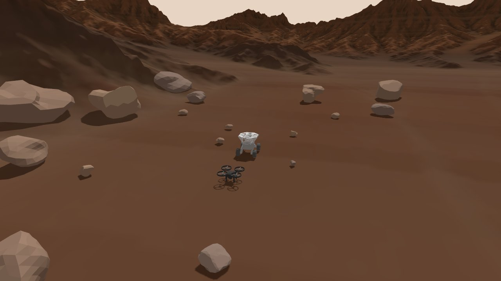
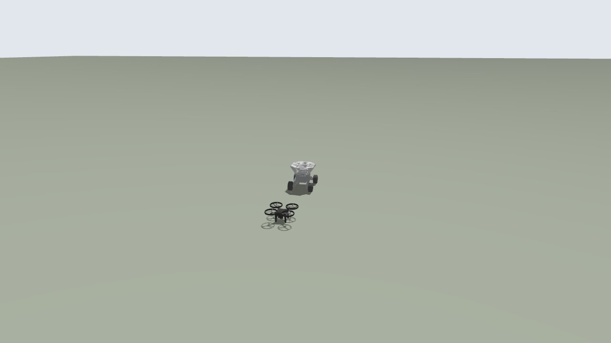

# uel_rover

드론(PX4) + 스키드 조향 로버 + 로버 위 착륙 플랫폼을 Gazebo Harmonic 에서 돌리는 ROS 2 Jazzy 워크스페이스.
드론과 로버의 하드웨어 값은 실기체에 맞춰 두었다 (아래 "하드웨어 값의 원본"). 바닥은 지구 평지와 화성 지형 중에서 고른다.

| 화성 (`environment:=mars`) | 지구 (기본) |
|---|---|
|  |  |

설치·빌드·실행: [LINUX_SETUP.md](LINUX_SETUP.md) — 저장소(`~/uel_rover`)가 그대로 colcon 워크스페이스다.

## 패키지

| 패키지 | 내용 | 자세히 |
|---|---|---|
| `src/spacek_rover` | 스키드 조향 로버 (바퀴 4, DiffDrive, 자동 주행 시험) | [README](src/spacek_rover/README.md) |
| `src/drone_landing_platform` | 착륙 포획 플랫폼 (접이판 4, 마커), 정지 로버 위 착륙 시나리오 | [README](src/drone_landing_platform/README.md) |
| `src/spacek_drone_sim` | 대회 드론 (Pixhawk 6X / PX4, H-Flow, 카메라 2대) + 마커 플랫폼 + 로버 통합 실행, 지구·화성 월드 | [README](src/spacek_drone_sim/README.md) |

## 빠른 시작 (PX4 없이)

```bash
cd ~/uel_rover && source /opt/ros/jazzy/setup.bash
colcon build && source install/setup.bash
ros2 launch spacek_drone_sim px4_rover_landing.launch.py px4:=false                     # 드론·로버·플랫폼, 카메라 토픽
ros2 launch spacek_drone_sim px4_rover_landing.launch.py px4:=false environment:=mars   # 같은 구성, 화성 지형·바위

# 로버 조종 (다른 터미널)
ros2 run teleop_twist_keyboard teleop_twist_keyboard --ros-args -r cmd_vel:=/rover/cmd_vel
```

PX4 로 드론까지 날리려면 [LINUX_SETUP.md](LINUX_SETUP.md) 4절 (PX4 준비) 뒤 `px4:=false` 를 빼고 실행한다.

## 시뮬 구성

| 대상 | 모델 | 값의 원본 | 색 |
|---|---|---|---|
| 드론 `spacek_drone` | 1.9 kg 쿼드, 7인치 3엽 프롭, PX4 SITL (기체 4901), H-Flow 광류·ToF, 전방 60° + 하방 카메라 (1280×720, 30 Hz) | `src/spacek_drone_sim/config/drone.yaml` | 검정 |
| 로버 `spacek_rover` | 스키드 조향 4륜 (DiffDrive), 바퀴 반지름 0.0877 m, 최고 0.459 m/s | `src/spacek_rover/config/rover.yaml` | 은색 |
| 플랫폼 `landing_platform` | 로버 위 착륙 포획 플랫폼, 접이판 4, AprilTag 36h11 마커 5개 | `src/drone_landing_platform/config/*.yaml`, `src/spacek_drone_sim/config/markers.yaml` | 흰색 |
| 지구 월드 | 초록 평지 (z = 0), PX4 기본 GPS 기준 위치 | `src/spacek_drone_sim/worlds/rover_landing_px4.sdf` | |
| 화성 월드 | 화성 지형 메시 (시각 전용) + 충돌 평면 + 바위 20개 (충돌 있음). 지구 중력 | `src/spacek_drone_sim/worlds/rover_landing_mars.sdf` | |

화성 월드의 언덕은 보이기만 하고 충돌이 없다. 원점 반경 약 6 m 안이 평평한 주행 영역이다 (자세히: [spacek_drone_sim README 5.1절](src/spacek_drone_sim/README.md)).
화성 지형 메시는 "Martian Terrain" by Kubocarte (Sketchfab, CC-BY-4.0) — [ATTRIBUTION](src/spacek_drone_sim/models/martian_surface/ATTRIBUTION.md).

## 이 시뮬로 코드 개발하기

자기 코드는 **새 ROS 2 패키지**로 `src/` 아래에 만들고, 아래 토픽만 써서 시뮬과 주고받는다. 시뮬 패키지 3개는 고치지 않아도 된다.

```bash
cd ~/uel_rover/src && ros2 pkg create --build-type ament_python my_nav --dependencies rclpy sensor_msgs geometry_msgs nav_msgs
cd ~/uel_rover && colcon build --packages-select my_nav && source install/setup.bash
```

| 토픽 | 방향 | 내용 |
|---|---|---|
| `/drone/front_camera/image_raw`, `/drone/down_camera/image_raw` (+ `camera_info`) | 시뮬 → 코드 | 드론 카메라 2대 (rgb8, 왜곡 계수 0) |
| `/rover/cmd_vel` (`geometry_msgs/Twist`) | 코드 → 시뮬 | 로버 속도 명령 |
| `/rover/odom` | 시뮬 → 코드 | 로버 휠 오도메트리 |
| `/rover/odom_gt`, `/air_ground/truth_pose` | 시뮬 → 코드 | 로버·드론 참값 (채점·비교용, 실기에는 없음) |
| `/platform/plate_*_joint/cmd_pos`, `/joint_states` | 양방향 | 플랫폼 접이판 |
| `/fmu/in/...`, `/fmu/out/...` (px4_msgs) | 양방향 | PX4 오프보드 제어·상태 (실기체와 같은 XRCE-DDS). `RMW_IMPLEMENTATION=rmw_fastrtps_cpp` 필요 |

- **같은 LAN 에 실기체나 다른 사람 시뮬이 있으면** PX4·Gazebo·ROS 2 가 섞인다. 격리해서 실행:
  `src/spacek_drone_sim/scripts/run_isolated.sh bash` 로 연 셸 안에서 launch 와 자기 노드를 함께 띄운다 ([LINUX_SETUP.md](LINUX_SETUP.md) 6절).
- 기체 값을 바꿀 때는 위 "값의 원본" 설정 파일만 고친다 (모델 SDF·PX4 기체 파일은 실행 때 여기서 만들어진다).
- 작업은 브랜치를 만들어 하고 PR 로 `main` 에 합친다. 시험: `colcon test --packages-select spacek_rover drone_landing_platform spacek_drone_sim`.

## 하드웨어 값의 원본

값은 설정 파일 한 곳에만 있고, 모델 SDF 와 PX4 기체 설정은 여기서 만들어진다. 바꿀 때는 이 파일만 고친다.

| 파일 | 담긴 것 | 실기체 근거 |
|---|---|---|
| `src/spacek_drone_sim/config/drone.yaml` | 질량 1.9 kg, 형상(CAD), 7인치 3엽 프롭, 모터 상수, 최대 추력/무게 4.97, 호버 출력 0.35, 센서 위치·화각, H-Flow 0.08~30 m, `px4_params` | 09-21 비행 로그, 08-31 PX4 파라미터 덤프, 10-16 모터·프롭 벤치 시험표, 카메라 실측 초점거리 |
| `src/spacek_rover/config/rover.yaml` | 바퀴 반지름 0.0877 m, 바퀴 최대 50 RPM (최고 0.459 m/s) | 1 m 직진 오도메트리, 펌웨어 MAX_RPM |
| `src/drone_landing_platform/config/*.yaml` | 플랫폼 치수, 접이판, 마커 | CAD |

전방 카메라는 60° 케이스(수평에서 아래로 60°)를 배터리 케이스 앞면에 끼운 배치다.

## 현재 상태와 한계

- 확인됨 (2026-11-03, RTX 3060 Ti): 지구·화성 월드 모두 모델 배치, 로버 주행, 카메라 2대. 화성 월드에서 PX4 이륙 2.3 m → 착륙, 바위 충돌.
  단위 시험 224개 (실패 3 = 기존 D213 독스트링 경고).
- 기본 PX4 설정은 실기처럼 GPS 융합 없이 광류 + 거리센서다. 정지비행·착륙 중 수평으로 약 1 m 흐를 수 있다.
- 로터 관성·반토크 계수·모터 시상수는 추정값이다.
- 카메라 렌즈 왜곡은 렌더링되지 않는다 (가제보 ogre2 한계). 시뮬 `camera_info` 의 왜곡 계수는 0 이다.
- 화성 월드: 중력·대기는 지구 값, 언덕 충돌 없음 (평평한 주행 영역 반경 약 6 m).
